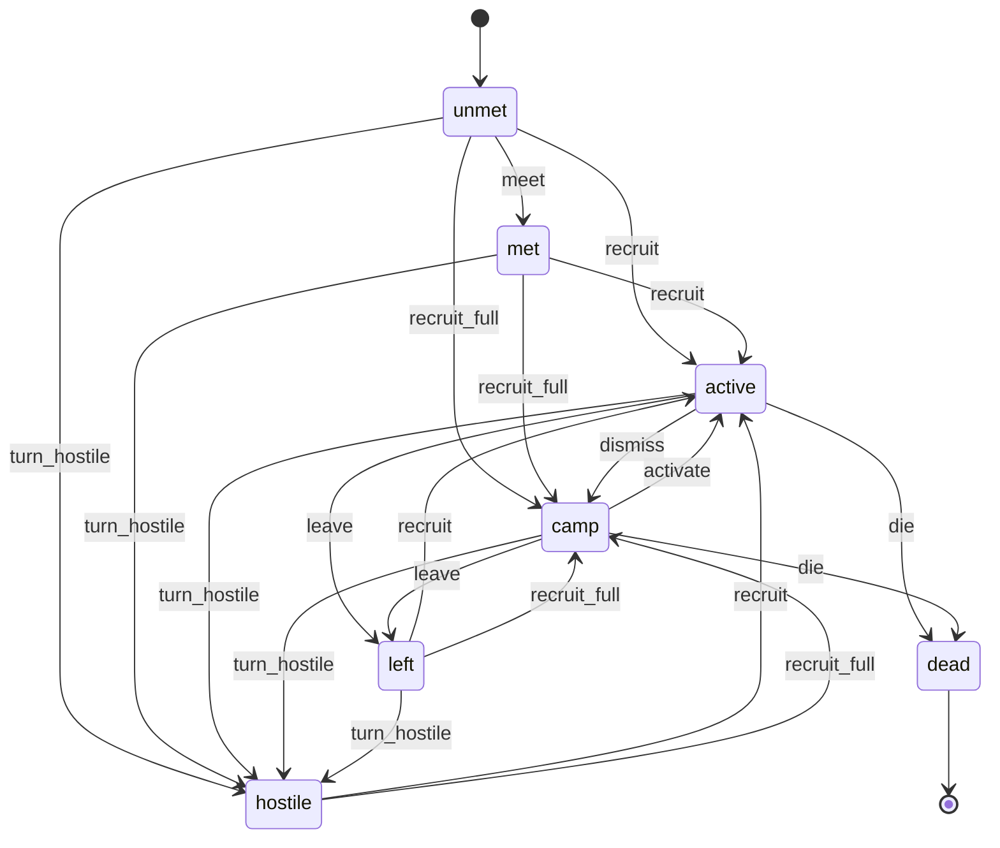
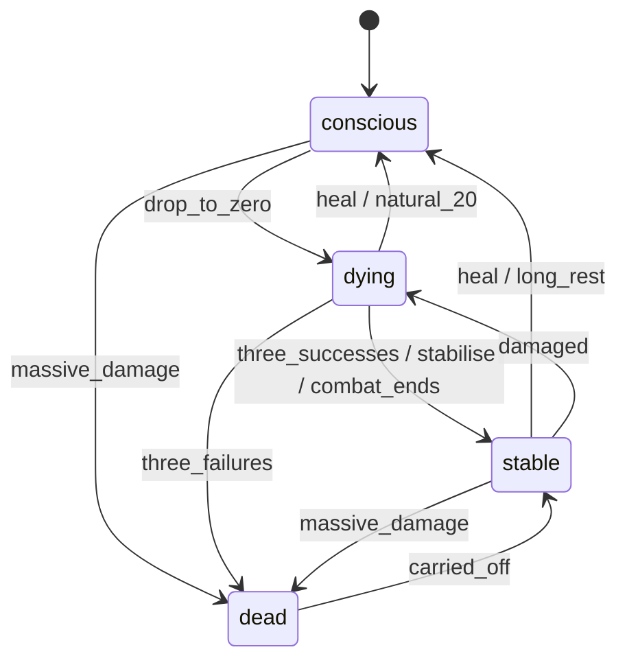
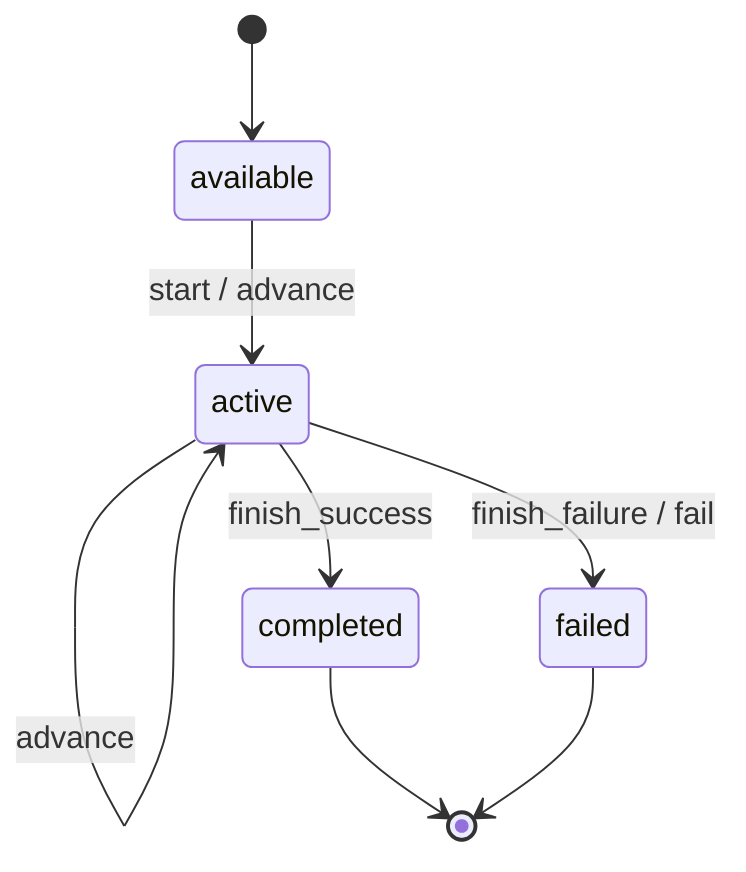
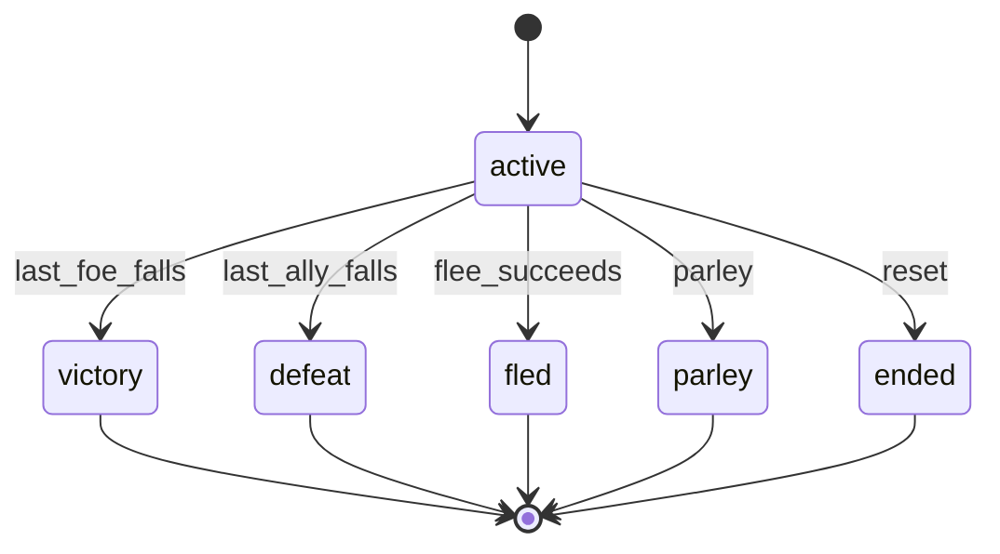
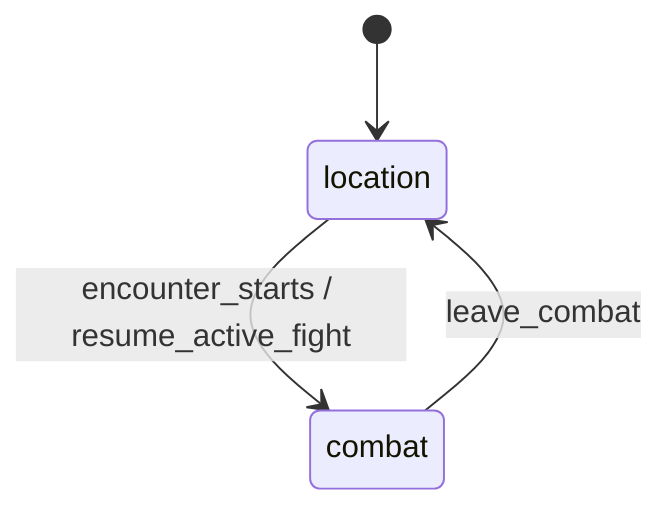

# State machines

<!-- GENERATED by src/tools/gen_state_machines.php — edit src/app/lib/*.php machine() tables, then run
     `php src/tools/gen_state_machines.php`. verify.sh fails when this file is stale. -->

Every lifecycle the game enforces is declared once, as a table, in `src/app/lib/`. The server
guards each status write with `StateMachine::guard()` / `allows()` (illegal moves are refused
and logged as `[state-machine] illegal transition {...}` in the PHP error log); the client reads
the same tables from `assets/js/state-machines.js` (`window.RivermarkStates`). Machine-readable
copy for agents: the JSON block under each heading, or `php src/tools/gen_state_machines.php --json`.

Implicit machines that were audited but deliberately left as they are are listed in
`docs/STATE_MACHINES_AUDIT.md`.

## Companion roster status (`companion_roster`)

Stored in: party_companions.status (ENUM)



| State | Meaning |
|---|---|
| `unmet` (initial) | Never met. No row yet, or the schema default. |
| `met` | Spoken to; recruit conditions may now be met. |
| `active` | Travelling with the party (in character_party). |
| `camp` | Recruited, waiting at camp (not in character_party). |
| `left` | Walked out over approval; can be won back where you met them. |
| `hostile` | Turned on the party. |
| `dead` (terminal) | Gone for good. Only reachable when CombatEngine::COMPANION_PERMADEATH is on. |

| From | Event | To |
|---|---|---|
| `unmet` | meet | `met` |
| `unmet` | recruit | `active` |
| `unmet` | recruit_full | `camp` |
| `met` | recruit | `active` |
| `met` | recruit_full | `camp` |
| `left` | recruit | `active` |
| `left` | recruit_full | `camp` |
| `hostile` | recruit | `active` |
| `hostile` | recruit_full | `camp` |
| `active` | dismiss | `camp` |
| `camp` | activate | `active` |
| `active` | leave | `left` |
| `camp` | leave | `left` |
| `unmet` | turn_hostile | `hostile` |
| `met` | turn_hostile | `hostile` |
| `active` | turn_hostile | `hostile` |
| `camp` | turn_hostile | `hostile` |
| `left` | turn_hostile | `hostile` |
| `active` | die | `dead` |
| `camp` | die | `dead` |

A missing party_companions row reads as `unmet`. The out-of-combat life state (conscious / unconscious / dead) is a separate machine, see `life_state`.

<details><summary>JSON</summary>

```json
{
    "name": "companion_roster",
    "title": "Companion roster status",
    "storage": "party_companions.status (ENUM)",
    "initial": "unmet",
    "states": {
        "unmet": "Never met. No row yet, or the schema default.",
        "met": "Spoken to; recruit conditions may now be met.",
        "active": "Travelling with the party (in character_party).",
        "camp": "Recruited, waiting at camp (not in character_party).",
        "left": "Walked out over approval; can be won back where you met them.",
        "hostile": "Turned on the party.",
        "dead": "Gone for good. Only reachable when CombatEngine::COMPANION_PERMADEATH is on."
    },
    "terminal": [
        "dead"
    ],
    "transitions": [
        {
            "from": "unmet",
            "event": "meet",
            "to": "met"
        },
        {
            "from": "unmet",
            "event": "recruit",
            "to": "active"
        },
        {
            "from": "unmet",
            "event": "recruit_full",
            "to": "camp"
        },
        {
            "from": "met",
            "event": "recruit",
            "to": "active"
        },
        {
            "from": "met",
            "event": "recruit_full",
            "to": "camp"
        },
        {
            "from": "left",
            "event": "recruit",
            "to": "active"
        },
        {
            "from": "left",
            "event": "recruit_full",
            "to": "camp"
        },
        {
            "from": "hostile",
            "event": "recruit",
            "to": "active"
        },
        {
            "from": "hostile",
            "event": "recruit_full",
            "to": "camp"
        },
        {
            "from": "active",
            "event": "dismiss",
            "to": "camp"
        },
        {
            "from": "camp",
            "event": "activate",
            "to": "active"
        },
        {
            "from": "active",
            "event": "leave",
            "to": "left"
        },
        {
            "from": "camp",
            "event": "leave",
            "to": "left"
        },
        {
            "from": "unmet",
            "event": "turn_hostile",
            "to": "hostile"
        },
        {
            "from": "met",
            "event": "turn_hostile",
            "to": "hostile"
        },
        {
            "from": "active",
            "event": "turn_hostile",
            "to": "hostile"
        },
        {
            "from": "camp",
            "event": "turn_hostile",
            "to": "hostile"
        },
        {
            "from": "left",
            "event": "turn_hostile",
            "to": "hostile"
        },
        {
            "from": "active",
            "event": "die",
            "to": "dead"
        },
        {
            "from": "camp",
            "event": "die",
            "to": "dead"
        }
    ],
    "notes": "A missing party_companions row reads as `unmet`. The out-of-combat life state (conscious / unconscious / dead) is a separate machine, see `life_state`."
}
```

</details>

## Life state (PC or companion) (`life_state`)

Stored in: derived: combatant {alive, hp, stable, unconscious} in combat_sessions.state_json; characters.current_hp + party_companions.status out of combat



| State | Meaning |
|---|---|
| `conscious` (initial) | Above 0 HP. Can act, travel and talk. |
| `dying` | 0 HP, unconscious, rolling death saves (combat only). |
| `stable` | 0 HP, unconscious, no longer rolling. Cannot act or talk. Wakes with any healing or a long rest. |
| `dead` | Gone. In combat: out for the fight. Outside: only with permadeath on. |

| From | Event | To |
|---|---|---|
| `conscious` | drop_to_zero | `dying` |
| `conscious` | massive_damage | `dead` |
| `dying` | three_successes | `stable` |
| `dying` | stabilise | `stable` |
| `dying` | three_failures | `dead` |
| `dying` | heal | `conscious` |
| `dying` | natural_20 | `conscious` |
| `stable` | heal | `conscious` |
| `stable` | long_rest | `conscious` |
| `stable` | damaged | `dying` |
| `stable` | massive_damage | `dead` |
| `dying` | combat_ends | `stable` |
| `dead` | carried_off | `stable` |

DEAD is terminal outside combat when permadeath is on (no revivify yet). With permadeath off (the default) `carried_off` brings the bled-out back to STABLE after the fight.

<details><summary>JSON</summary>

```json
{
    "name": "life_state",
    "title": "Life state (PC or companion)",
    "storage": "derived: combatant {alive, hp, stable, unconscious} in combat_sessions.state_json; characters.current_hp + party_companions.status out of combat",
    "initial": "conscious",
    "states": {
        "conscious": "Above 0 HP. Can act, travel and talk.",
        "dying": "0 HP, unconscious, rolling death saves (combat only).",
        "stable": "0 HP, unconscious, no longer rolling. Cannot act or talk. Wakes with any healing or a long rest.",
        "dead": "Gone. In combat: out for the fight. Outside: only with permadeath on."
    },
    "terminal": [],
    "transitions": [
        {
            "from": "conscious",
            "event": "drop_to_zero",
            "to": "dying"
        },
        {
            "from": "conscious",
            "event": "massive_damage",
            "to": "dead"
        },
        {
            "from": "dying",
            "event": "three_successes",
            "to": "stable"
        },
        {
            "from": "dying",
            "event": "stabilise",
            "to": "stable"
        },
        {
            "from": "dying",
            "event": "three_failures",
            "to": "dead"
        },
        {
            "from": "dying",
            "event": "heal",
            "to": "conscious"
        },
        {
            "from": "dying",
            "event": "natural_20",
            "to": "conscious"
        },
        {
            "from": "stable",
            "event": "heal",
            "to": "conscious"
        },
        {
            "from": "stable",
            "event": "long_rest",
            "to": "conscious"
        },
        {
            "from": "stable",
            "event": "damaged",
            "to": "dying"
        },
        {
            "from": "stable",
            "event": "massive_damage",
            "to": "dead"
        },
        {
            "from": "dying",
            "event": "combat_ends",
            "to": "stable"
        },
        {
            "from": "dead",
            "event": "carried_off",
            "to": "stable"
        }
    ],
    "notes": "DEAD is terminal outside combat when permadeath is on (no revivify yet). With permadeath off (the default) `carried_off` brings the bled-out back to STABLE after the fight."
}
```

</details>

## Quest status (per party) (`quest_status`)

Stored in: party_quests.status (ENUM) + current_stage_id, resolution, ended_at



| State | Meaning |
|---|---|
| `available` (initial) | Offered (or no row yet). Not started. |
| `active` | Under way; current_stage_id is where it stands. |
| `completed` (terminal) | Ended on a success or neutral terminal stage. Rewards paid once. |
| `failed` (terminal) | Ended on a failure stage, or failed outright by content. |

| From | Event | To |
|---|---|---|
| `available` | start | `active` |
| `available` | advance | `active` |
| `active` | advance | `active` |
| `active` | finish_success | `completed` |
| `active` | finish_failure | `failed` |
| `active` | fail | `failed` |

A missing party_quests row reads as `available`. Re-offering a terminal quest is a note, not an error, so a second NPC offering the same job does not end the conversation.

<details><summary>JSON</summary>

```json
{
    "name": "quest_status",
    "title": "Quest status (per party)",
    "storage": "party_quests.status (ENUM) + current_stage_id, resolution, ended_at",
    "initial": "available",
    "states": {
        "available": "Offered (or no row yet). Not started.",
        "active": "Under way; current_stage_id is where it stands.",
        "completed": "Ended on a success or neutral terminal stage. Rewards paid once.",
        "failed": "Ended on a failure stage, or failed outright by content."
    },
    "terminal": [
        "completed",
        "failed"
    ],
    "transitions": [
        {
            "from": "available",
            "event": "start",
            "to": "active"
        },
        {
            "from": "available",
            "event": "advance",
            "to": "active"
        },
        {
            "from": "active",
            "event": "advance",
            "to": "active"
        },
        {
            "from": "active",
            "event": "finish_success",
            "to": "completed"
        },
        {
            "from": "active",
            "event": "finish_failure",
            "to": "failed"
        },
        {
            "from": "active",
            "event": "fail",
            "to": "failed"
        }
    ],
    "notes": "A missing party_quests row reads as `available`. Re-offering a terminal quest is a note, not an error, so a second NPC offering the same job does not end the conversation."
}
```

</details>

## Combat encounter lifecycle (`combat_status`)

Stored in: combat_sessions.state_json.status + combat_sessions.is_active



| State | Meaning |
|---|---|
| `active` (initial) | Fight in progress; turn order in state.order / turn_index. |
| `victory` (terminal) | No foe standing, a party member still up. XP, gold, loot, encounter cleared. |
| `defeat` (terminal) | No party member standing. Everyone wakes at the module haven on 1 HP. |
| `fled` (terminal) | The party broke away (DEX check vs flee DC). |
| `parley` (terminal) | Weapons lowered; hands over to the parley dialogue node. |
| `ended` (terminal) | Retired without awards (stale engine version / reset). |

| From | Event | To |
|---|---|---|
| `active` | last_foe_falls | `victory` |
| `active` | last_ally_falls | `defeat` |
| `active` | flee_succeeds | `fled` |
| `active` | parley | `parley` |
| `active` | reset | `ended` |

Every terminal state is written by CombatEngine::finish() through this table and then persisted with is_active = 0 by finalizeCombat().

<details><summary>JSON</summary>

```json
{
    "name": "combat_status",
    "title": "Combat encounter lifecycle",
    "storage": "combat_sessions.state_json.status + combat_sessions.is_active",
    "initial": "active",
    "states": {
        "active": "Fight in progress; turn order in state.order / turn_index.",
        "victory": "No foe standing, a party member still up. XP, gold, loot, encounter cleared.",
        "defeat": "No party member standing. Everyone wakes at the module haven on 1 HP.",
        "fled": "The party broke away (DEX check vs flee DC).",
        "parley": "Weapons lowered; hands over to the parley dialogue node.",
        "ended": "Retired without awards (stale engine version / reset)."
    },
    "terminal": [
        "victory",
        "defeat",
        "fled",
        "parley",
        "ended"
    ],
    "transitions": [
        {
            "from": "active",
            "event": "last_foe_falls",
            "to": "victory"
        },
        {
            "from": "active",
            "event": "last_ally_falls",
            "to": "defeat"
        },
        {
            "from": "active",
            "event": "flee_succeeds",
            "to": "fled"
        },
        {
            "from": "active",
            "event": "parley",
            "to": "parley"
        },
        {
            "from": "active",
            "event": "reset",
            "to": "ended"
        }
    ],
    "notes": "Every terminal state is written by CombatEngine::finish() through this table and then persisted with is_active = 0 by finalizeCombat()."
}
```

</details>

## Game client screen mode (`ui_mode`)

Stored in: client only: G().state.mode (assets/js/game.js)



| State | Meaning |
|---|---|
| `location` (initial) | Exploring: painted scene, map or first-person view of the current location. |
| `combat` | The battle board is up; game.js key handling stands down. |

| From | Event | To |
|---|---|---|
| `location` | encounter_starts | `combat` |
| `location` | resume_active_fight | `combat` |
| `combat` | leave_combat | `location` |

Sub-views (scene / map / first-person, sheet and camp overlays, spell aiming) are audited in docs/STATE_MACHINES_AUDIT.md and left implicit for now.

<details><summary>JSON</summary>

```json
{
    "name": "ui_mode",
    "title": "Game client screen mode",
    "storage": "client only: G().state.mode (assets/js/game.js)",
    "initial": "location",
    "states": {
        "location": "Exploring: painted scene, map or first-person view of the current location.",
        "combat": "The battle board is up; game.js key handling stands down."
    },
    "terminal": [],
    "transitions": [
        {
            "from": "location",
            "event": "encounter_starts",
            "to": "combat"
        },
        {
            "from": "location",
            "event": "resume_active_fight",
            "to": "combat"
        },
        {
            "from": "combat",
            "event": "leave_combat",
            "to": "location"
        }
    ],
    "notes": "Sub-views (scene / map / first-person, sheet and camp overlays, spell aiming) are audited in docs/STATE_MACHINES_AUDIT.md and left implicit for now."
}
```

</details>

